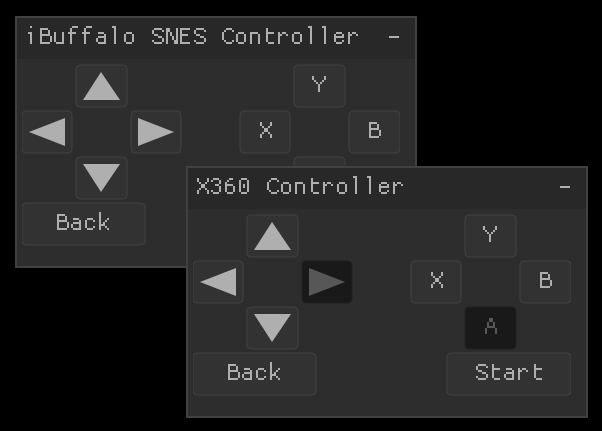

# nuklear_gamepad

Gamepad API for [Nuklear](https://github.com/Immediate-Mode-UI/Nuklear).



## Example

``` c
#define NK_GAMEPAD_IMPLEMENTATION
#define NK_GAMEPAD_SDL3
//#define NK_GAMEPAD_SDL
//#define NK_GAMEPAD_GLFW
//#define NK_GAMEPAD_RAYLIB
//#define NK_GAMEPAD_PNTR
//#define NK_GAMEPAD_KEYBOARD
//#define NK_GAMEPAD_MOUSE
//#define NK_GAMEPAD_NONE
#include "nuklear_gamepad.h"

// Initialize the gamepad system.
struct nk_gamepads gamepads;
nk_gamepad_init(&gamepads, ctx, NULL);

// Act on whether or not the A button is pushed
if (nk_gamepad_is_button_down(&gamepads, 0, NK_GAMEPAD_BUTTON_A)) {
    nk_label(ctx, "Button A is down", NK_TEXT_LEFT);
}

// Clear the gamepad state.
nk_gamepad_free(&gamepads);
```

## Platform Support

- [SDL2](https://www.libsdl.org/) (`nuklear_gamepad_sdl.h`)
- [SDL3](https://www.libsdl.org/) (`nuklear_gamepad_sdl3.h`)
- [GLFW](https://www.glfw.org/) (`nuklear_gamepad_glfw.h`)
- [raylib](https://www.raylib.com/) (`nuklear_gamepad_raylib.h`)
- [pntr](https://github.com/robloach/pntr) with [pntr_app](https://github.com/robloach/pntr_app) (`nuklear_gamepad_pntr.h`)
- Keyboard, using Nuklear's keyboard input (`nuklear_gamepad_keyboard.h`)
- Mouse, using Nuklear's mouse input (`nuklear_gamepad_mouse.h`)
- None, or a [Custom](#custom-integration) input source (`nuklear_gamepad_none.h`)
- [Add more!](https://github.com/RobLoach/nuklear_gamepad/issues)

## API

``` c
nk_bool nk_gamepad_init(struct nk_gamepads* gamepads, struct nk_context* ctx, void* user_data);
nk_bool nk_gamepad_init_with_source(struct nk_gamepads* gamepads, struct nk_context* ctx, struct nk_gamepad_input_source input_source);
void nk_gamepad_free(struct nk_gamepads* gamepads);
void nk_gamepad_update(struct nk_gamepads* gamepads);
nk_bool nk_gamepad_is_available(struct nk_gamepads* gamepads, int num);
void nk_gamepad_set_available(struct nk_gamepads* gamepads, int num, nk_bool available);
nk_bool nk_gamepad_is_button_down(struct nk_gamepads* gamepads, int num, enum nk_gamepad_button button);
nk_bool nk_gamepad_is_button_pressed(struct nk_gamepads* gamepads, int num, enum nk_gamepad_button button);
nk_bool nk_gamepad_is_button_released(struct nk_gamepads* gamepads, int num, enum nk_gamepad_button button);
nk_bool nk_gamepad_any_button_pressed(struct nk_gamepads* gamepads, int num, int* out_num, enum nk_gamepad_button* out_button);
nk_bool nk_gamepad_any_button_released(struct nk_gamepads* gamepads, int num, int* out_num, enum nk_gamepad_button* out_button);
nk_bool nk_gamepad_any_button_down(struct nk_gamepads* gamepads, int num, int* out_num, enum nk_gamepad_button* out_button);
void nk_gamepad_button(struct nk_gamepads* gamepads, int num, enum nk_gamepad_button button, nk_bool down);
float nk_gamepad_get_axis(struct nk_gamepads* gamepads, int num, enum nk_gamepad_axis axis);
void nk_gamepad_axis(struct nk_gamepads* gamepads, int num, enum nk_gamepad_axis axis, float value);
int nk_gamepad_count(struct nk_gamepads* gamepads);
const char* nk_gamepad_name(struct nk_gamepads* gamepads, int num);
const char* nk_gamepad_button_name(struct nk_gamepads* gamepads, enum nk_gamepad_button button);
const char* nk_gamepad_axis_name(struct nk_gamepads* gamepads, enum nk_gamepad_axis axis);
struct nk_gamepad_input_source* nk_gamepad_input_source(struct nk_gamepads* gamepads);
nk_bool nk_gamepad_set_input_source(struct nk_gamepads* gamepads, struct nk_gamepad_input_source input_source);
nk_bool nk_gamepad_input_source_supports(struct nk_gamepads* gamepads, unsigned int capabilities);
int nk_gamepad_input_source_count(void);
extern nk_gamepad_input_source_fn nk_gamepad_input_sources[];
```

### Capabilities

Not every platform provides every feature, so input sources advertise what they
support. Use `nk_gamepad_input_source_supports()` to check at runtime; it only
returns true when *every* requested capability is available.

``` c
if (nk_gamepad_input_source_supports(&gamepads, NK_GAMEPAD_CAP_AXES)) {
    float x = nk_gamepad_get_axis(&gamepads, 0, NK_GAMEPAD_AXIS_LEFT_X);
}
```

| Capability | Description | Supported by |
| ---------- | ----------- | ------------ |
| `NK_GAMEPAD_CAP_AXES` | Reports analog axis values through `nk_gamepad_get_axis()` | SDL, SDL3, GLFW, raylib, Mouse |
| `NK_GAMEPAD_CAP_HOTPLUG` | Detects gamepads connecting and disconnecting while running | SDL, SDL3, GLFW, raylib |
| `NK_GAMEPAD_CAP_BUTTON_NAMES` | Provides its own button names rather than the built-in ones | SDL3, Keyboard, Mouse |
| `NK_GAMEPAD_CAP_RUMBLE` | Supports haptic rumble | None yet |

## Configuration

| Define | Description  |
| ------ | ------------ |
| `NK_GAMEPAD_IMPLEMENTATION` | Include the implementation, in exactly one source file |
| `NK_GAMEPAD_HEADER_ONLY` | Skip the implementation, even if `NK_GAMEPAD_IMPLEMENTATION` is defined |
| `NK_GAMEPAD_NONE`     | When set, will avoid detecting which platform to use |
| `NK_GAMEPAD_SDL`      | Use [SDL2](https://www.libsdl.org/) |
| `NK_GAMEPAD_SDL3`     | Use [SDL3](https://www.libsdl.org/) |
| `NK_GAMEPAD_GLFW`     | Use [glfw](https://www.glfw.org/) |
| `NK_GAMEPAD_RAYLIB`   | Use [raylib](https://github.com/raysan5/raylib) |
| `NK_GAMEPAD_PNTR`     | Use [pntr_app](https://github.com/robloach/pntr_app) |
| `NK_GAMEPAD_KEYBOARD` | Use Nuklear's keyboard interface to emulate gamepad input |
| `NK_GAMEPAD_MOUSE`    | Use Nuklear's mouse interface to emulate gamepad input |
| `NK_GAMEPAD_DEFAULT_INPUT_SOURCE` | Input source used by `nk_gamepad_init()`. Defaults to `nk_gamepad_input_sources[0]`, the first compiled one |
| `NK_GAMEPAD_MAX`      | Maximum amount of gamepads supported. Defaults to `4` |
| `NK_GAMEPAD_NAME_PREFIX` | Prefix for the default gamepad names. Defaults to `"Controller "` |
| `NK_GAMEPAD_NAME_SIZE` | Maximum string size of gamepad names. Defaults to `32` |
| `NK_GAMEPAD_TRIGGER_THRESHOLD` | How far an analog trigger travels, from `0.0f` to `1.0f`, before it reports as L2/R2. Defaults to `0.5f` |
| `NK_GAMEPAD_MOUSE_SENSITIVITY` | Pixels of mouse delta per frame to reach a full axis. Defaults to `12.0f` |
| `NK_GAMEPAD_MOUSE_DPAD_THRESHOLD` | Mouse axis magnitude at which D-pad buttons count as pressed. Defaults to `0.999f` |

The library version is available through `NK_GAMEPAD_VERSION` (a string, like `"1.0.2"`), along with `NK_GAMEPAD_VERSION_MAJOR`, `NK_GAMEPAD_VERSION_MINOR` and `NK_GAMEPAD_VERSION_PATCH`.

## Custom Integration

To define your own custom input source, use `NK_GAMEPAD_NONE` and pass in your own `struct nk_gamepad_input_source`...

```c
#define NK_GAMEPAD_NONE
#define NK_GAMEPAD_IMPLEMENTATION
#include "nuklear_gamepad.h"

// Globals
struct nk_gamepads gamepads;

// Initialize the gamepad.
struct nk_gamepad_input_source input_source = {
    .user_data = NULL, // Optional user_data pointer
    .init = NULL, // Function to initialize the input source
    .update = &my_own_gamepad_update, // Function to update the status of the gamepad
    .free = NULL, // Function used to free up the gamepad data
    .name = NULL, // Function used to get the name of each gamepad
    .button_name = NULL, // Function used to get the label of a gamepad button
    .axis_name = NULL, // Function used to get the label of a gamepad axis
    .input_source_name = "my_own_gamepad", // The optional name of the input source
    .id = NK_GAMEPAD_INPUT_SOURCE_NONE, // Optional identification for the input source
    .capabilities = NK_GAMEPAD_CAP_AXES, // Optional bitmask of the features the source provides
};
nk_gamepad_init_with_source(&gamepads, ctx, input_source);

// Update the gamepad status
nk_gamepad_update(&gamepads);

// Free it
nk_gamepad_free(&gamepads);
```

## Platform Quirks

When using SDL, pass your events through so that controllers plugged in or unplugged while running are picked up:

``` c
while (SDL_PollEvent(&event)) {
    nk_gamepad_sdl3_handle_event(&gamepads, &event);
}
```

## License

Unless stated otherwise, all works are:

- Copyright (c) 2026 [Rob Loach](https://robloach.net)

... and licensed under:

- [zlib License](LICENSE)
